 

  <picture>
    <source media="(prefers-color-scheme: dark)" srcset="./dark.svg">
    <source media="(prefers-color-scheme: light)" srcset="./light.svg">
    
  </picture>

  <a href="https://www.adeelsayyad.tech">Portfolio</a>
  &nbsp; • &nbsp;
  <a href="https://www.linkedin.com/in/adeelsayyad/">LinkedIn</a>
  &nbsp; • &nbsp;
  <a href="https://github.com/SayyadAdeel-a?tab=repositories">Repositories</a>

---

### 👋 A little about me

I get curious about random things, try to figure out how they work, and eventually attempt to build something out of them.

Most of my experiments involve AI tools, a little creativity, and a lot of trial and error.

Sometimes things work. Sometimes I create more problems than I solve. :)

### 🕸️ Currently exploring

`AI Agents` · `Prototyping` · `Product Ideas` · `Creative Experiments`

---

### 🎮 Player stats — live from GitHub

  
  

  

Stats are retrieved from GitHub activity and repository data. Availability and refresh rates depend on the external services.

### 🧮 How levels and language ranks are calculated

No manually inflated numbers. The goal is to make the stats traceable to GitHub data.

**Level & XP**

A custom scoring system based on GitHub activity:

| Activity | XP |
|---|---:|
| Contributions | 1 XP |
| Commits | 1 XP |
| Pull requests | 5 XP |
| Stars received | 5 XP |
| Public repositories | 2 XP |

**Level progression**

| Level | XP required |
|---|---:|
| Level 1 | 0–999 |
| Level 2 | 1,000–2,999 |
| Level 3 | 3,000–5,999 |
| Level 4 | 6,000–8,999 |
| Level 5 | 9,000–13,999 |
| Level 6 | 14,000+ |

**Language rankings**

Language rankings are based on the code statistics returned by GitHub's repository language API.

They represent the volume of code in repositories, not actual programming proficiency.

Scoring formula is custom, not an official GitHub ranking. Live XP and level calculations require a GitHub Actions workflow to fetch, calculate and publish the results. The tables above define the scoring rules, not a claim about my current level.

---

### 🛠️ Tech stack

**AI & Agentic Tools**

`Claude Code` · `OpenCode` · `Codex` · `Antigravity`

**Web Fundamentals**

  

**Development & Deployment**

  

**Areas of interest**

`Prompt Engineering` · `Generative AI` · `AI-assisted Prototyping` · `Product Ideation` · `Automation`

Tools and technologies reflect my experimentation and learning, not necessarily professional proficiency in every item.

---

  <i>Still learning. Still experimenting. Still figuring things out.</i>

